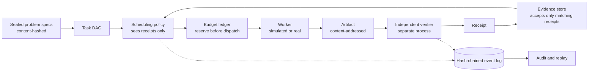

# FRONTIER

[](https://github.com/Kesh3805/frontier/actions/workflows/ci.yml)


**Does deciding *which attempt runs next* get more independently verified
results out of a fixed compute budget?**

FRONTIER is a research program of Ostrium Labs. It tests, with
preregistered experiments, whether adaptive allocation of compute across
many verifier-checked research attempts beats strong fixed-allocation
baselines. It also asks how much verification quality and cost change the
answer. It is built so that a skeptical reviewer can re-run and audit every
number.

> **What this is not.** FRONTIER makes no scientific-discovery claims.
> Most results so far are from simulation or from a deterministic
> **non-LLM** worker on small algorithm tasks, and they are labelled as
> such. Hybrid latent/text reasoning (HybridAgent) has not been tested yet:
> there is no GPU here, and no matched text-only baseline has been released.

---

## Findings so far

Each line links to a preregistered experiment with its frozen protocol,
scoring script, raw per-run data and an honest scorecard, including
failed predictions.

| # | Kind | Finding | Status |
|---|---|---|---|
| [exp-000](results/exp-000/README.md) | simulation | Adaptive (Thompson) allocation beat round-robin in 5 of 6 primary cells but **lost** in one. | H1-sim **rejected** as stated (unchanged on kernel 0.3) |
| [exp-001](results/exp-001/README.md) | simulation | The loss replicates. The advantage survives correlated failures and noisy verifiers. **A 2% per-check false-positive rate makes 8–25% of accepted results false.** | — |
| [exp-002](results/exp-002/README.md) | simulation | Mechanism: optimistic hints on *undetected dead problems* (+47 wasted attempts). Flag those problems and the loss becomes a gain. | mechanism **supported** |
| [exp-003](results/exp-003/README.md) | real tasks | First pilot on 34 real tasks with a real subprocess verifier. The predicted waste on dead tasks reproduced; real verifier false acceptances measured. | superseded by exp-004 |
| [exp-004](results/exp-004/README.md) | real tasks | **Task order leaked into the baselines** (FIFO −9.0 when shuffled). With order shuffled, hinted Thompson wins clearly at a scarce budget (**+1.86 [1.47, 2.26]** of 26 live tasks on kernel 0.3), is not significant at 240 and gains +0.25 [0.09, 0.41] at 480. | H1 pilot **inconclusive** |
| [exp-005](results/exp-005/README.md) | verification | The 40-case hidden suite accepted 1.8% of wrong programs (boundary bugs). 40 cases with small values accepted none. | frozen verdict **refuted** (floor effect); led to suite v2 |
| [exp-006](results/exp-006/README.md) | real tasks | A stronger hidden suite (199 checks, 4.6× the cost) removed every false solve, but **cost 1–4 true solves per run**; with expensive verification, hinted Thompson's scarce-budget margin roughly doubles (+3.41). | strong verification **costs yield** |
| [rerun-k0.3](results/rerun-k0.3/README.md) | all | Corrected re-runs after errata E1/E2. **No frozen verdict changed**; exp-004's P3/P4 now hold; some magnitudes moved (exp-000 R2-scarce +1.46 → +0.33; real-task hint-free loss −0.95 → −0.12, n.s.). | errata applied |

**Takeaways so far, each with its uncertainty:**

1. Adaptive allocation is **not uniformly better** than a good round-robin
   baseline. It helps most when the budget is scarce.
2. **Difficulty hints and learning interact.** On real tasks, hinted
   Thompson (+1.86) clearly beats both a static hint index (+0.29, not
   significant) and hint-free Thompson (−0.12, not significant) at a scarce
   budget. Confident hints on unsolvable problems are the main failure
   mode found so far.
3. **Verification quality and verification cost both matter.** Weak
   hidden suites let wrong answers through, and more attempts amplify that.
   But a 4.6× costlier suite removed about 0.05 false solves per run at the
   price of 1–4 true ones. Verification cost belongs inside the allocation
   problem.
4. **Infrastructure details can silently bias a comparison.** Task order
   and lowest-index tie-breaking did here. Platform-dependent floating
   point broke cross-binary reproducibility, though not a conclusion. Two
   runner bugs, found by independent review, stranded budget and
   mis-counted repeated failures ([errata](docs/research/errata.md)). Each
   was disclosed, fixed, and is being re-run.

Program-level hypothesis status is kept in
[`docs/research/scope.md`](docs/research/scope.md).

---

## How it works



- **Rust control plane** (`crates/`):
  - sealed problem specs;
  - a task DAG with lifecycle states;
  - a hard-cap budget ledger, where every attempt reserves its worst-case
    cost before it starts;
  - a content-addressed evidence store;
  - nine allocation policies;
  - a discrete-event runner;
  - an append-only, hash-chained event log.
- **Python execution layer** (`python/`):
  - a property-test verifier that runs untrusted candidates in a separate
    interpreter;
  - the real-task suite and a deterministic DSL program-search worker;
  - paired-bootstrap statistics;
  - adapters for hosted models and HybridAgent (interface only).
- **Interface:** versioned JSON/JSONL contracts (`schemas/`). A Python
  service is driven by the Rust runner over stdin/stdout.

## Evidence standards

- **Acceptance is earned only through verifier receipts.** A receipt must
  be bound to the sealed spec digest and the exact artifact, and meet the
  required trust class. Model confidence is recorded but never read by
  acceptance logic.
- **Claims are tiered:** `plausible_candidate` < `mechanically_verified` <
  `empirically_reproduced` < `independently_reviewed` <
  `scientifically_accepted`. Software can reach `mechanically_verified` at
  most. Real-task receipts are currently **trust class V1**: subprocess
  isolation without an OS sandbox.
- **Every reported metric is recomputed from the event log** (`frontier
  audit`). The audit rejects tampering, budget overruns, unsupported
  acceptances and double solves.
- **Preregistration:** hypotheses, configs, analysis and scoring scripts are
  hashed and committed *before* a run. Deviations, confounds and errata are
  written into the results, never retro-fitted.

---

## Quick start

Requirements: Rust ≥ 1.85, Python ≥ 3.11 with `numpy`, `jsonschema` and
`pytest`. CPU only.

```bash
cargo test --workspace
```

```bash
python -m pytest python -q
```

```bash
cargo build --release -p frontier-cli
```

```bash
bash scripts/qualify.sh
```

`qualify.sh` runs a simulated campaign, audits it, replays it bit-for-bit,
checks that a forged verdict is rejected, and runs a real-task campaign
twice to confirm the logs are identical.

**Run a simulated campaign, audit it and replay it:**

```bash
target/release/frontier run --config configs/smoke.json --out runs/smoke
```

```bash
target/release/frontier audit --events runs/smoke/events.jsonl --summary runs/smoke/summary.json
```

```bash
target/release/frontier replay --config configs/smoke.json --events runs/smoke/events.jsonl
```

**Run one campaign on real tasks.** Real candidate programs go through the
real verifier:

```bash
target/release/frontier real-run --config research/realtasks/dev.json --seed 1 --policy-index 1 --out runs/real
```

Dependency-structured real tasks (catalog v3) work the same way. Each
problem can be solved directly or through lemma tasks; verified lemmas are
passed to dependent attempts as helper functions, and the artifact commits
to them (`python/frontier_py/realtasks/deps.py` describes the design):

```bash
target/release/frontier real-run --config research/realtasks/dev-v3.json --seed 1 --policy-index 1 --out runs/real-v3
```

**Reproduce a preregistered experiment and its analysis:**

```bash
target/release/frontier real-experiment --config research/preregistration/exp-004/b60.json --out runs/exp-004/b60
```

```bash
python research/preregistration/exp-004/evaluate_primary.py runs/exp-004
```

## Reproducibility

- **Determinism:**
  - all randomness comes from in-tree SplitMix64 streams keyed by
    (seed, label);
  - the math is portable (fdlibm `ln`/`exp`; see ADR-0003 and
    `crates/frontier-core/src/detmath.rs`);
  - a pinned smoke-run log head is checked in CI on Linux, and matches the
    Windows result.
- **Paired comparisons:** the k-th attempt on a task has the same outcome
  under every policy (common random numbers), so policy differences are
  measured on identical luck.
- **Provenance:** every experiment manifest records the source commit, a
  dirty-tree flag, the config digest, the results hash and the host.
  Per-run CSVs keep each run's log head, so any single run can be
  regenerated and checked.
- **Real-task logs are platform-specific:** receipt reasons name the OS
  harness.

## Repository layout

| Path | Contents |
|---|---|
| `crates/frontier-core` | Specs, task DAG, budget ledger, evidence, event log, deterministic RNG and math |
| `crates/frontier-sched` | Allocation policies: FIFO, fixed slice, round-robin, random, static prior, elimination, UCB, Thompson, oracle (diagnostic) |
| `crates/frontier-sim` | Synthetic environment, discrete-event runner, external real-task backend, audit, experiment grids |
| `crates/frontier-cli` | The `frontier` binary |
| `python/frontier_py` | Verifier, real-task suite and worker, worker service, statistics, model adapters |
| `research/preregistration/` | Frozen protocols, configs and scoring scripts (exp-000 to exp-006) |
| `research/realtasks/` | Task catalogs (v1, v2; v3 = dependency-structured problems with lemma routes) with hashed hidden-suite commitments |
| `results/` | Executed results, scorecards, per-run data, manifests |
| `docs/research/` | Scope, source audit, literature review, simulator calibration |
| `docs/decisions/` | Architecture decision records |
| `docs/archive/` | The original dossier (v0.1), verbatim |
| `schemas/` | JSON Schema data contracts |

## Limits

- **Worker:** the real-task worker is DSL program search, not an LLM. LLM
  attempts may have very different success and cost distributions.
- **Task suite:** 34 small list-processing tasks written by the project.
  Single-step only; no dependency structure on real tasks yet.
- **Verifier isolation:** V1 only. Network and filesystem are not isolated,
  so model-generated code must not be run until a sandboxed (V2) image
  exists.
- **Cost:** costs are in deterministic compute units, not dollars. No paid
  compute has been used.

## Roadmap

1. exp-006: the cost of stronger verification (running); then fail-fast
   verification charging.
2. **Stage 2:** an LLM worker on a harder, held-out task set, with response
   caching for exact replay. *Requires an explicit spending
   authorisation.*
3. A sandboxed (V2) verifier image; Lean tasks with a pinned
   toolchain.
4. HybridAgent reproduction and a matched text-only baseline. *Requires a
   GPU and training budget.*

## License and attribution

Apache License 2.0; see [`LICENSE`](LICENSE) and [`NOTICE`](NOTICE).
Third-party papers, code and models are cited where used and keep their own
licenses. These include HybridAgent (MIT) and its checkpoints (MIT), the
fdlibm-derived math (Sun Microsystems notice preserved in `detmath.rs`),
and the benchmark and model terms of anything used later.
