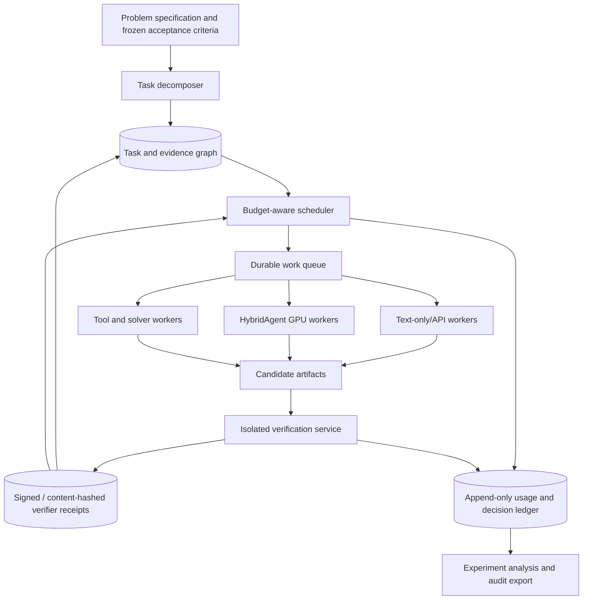
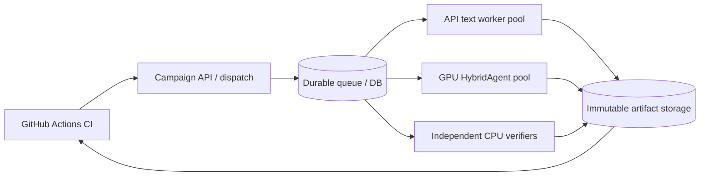

> **Status: PROPOSAL / NOT YET TESTED.** This is a research charter and experimental-design dossier, not a report of completed Frontier experiments. Improvements and hardware sizes are hypotheses or planning estimates, not measured Frontier results.

# Reader's guide

The dossier comprises a full scientific rationale, methodology and reproducible system specification. The public links in its references were checked on 26 October 2026; live runner offerings, model revisions and prices may change. The companion ZIP includes schema examples, CI templates and config.


\clearpage

# 01 — Research charter

## Abstract

We propose FRONTIER, a software-first research system combining (a) agentic task decomposition and reusable evidence, (b) hybrid latent/text reasoning workers where available, (c) adaptive allocation of inference/tool/verification budgets, and (d) independent artifact-level verification. The goal is to test whether **verified discovery yield per end-to-end compute dollar and unit wall time** improves over strong single-agent and multi-agent baselines. The program is not to create an agent framework solely for automation, nor to claim that better mathematical problem solving immediately accelerates scientific translation into deployed capabilities.

## Motivation and missing piece

Generative agents can massively parallelize conjecture formation, literature synthesis, candidate derivations and code generation. Yet naively increasing worker count may waste resources on duplicate explorations, poor branch selection, long histories, speculative false results and unproductive tool calls. Meanwhile latent reasoning may reduce the overhead of individual inference trajectories, but does not inherently coordinate multiple researchers or create scientifically trustworthy results. We study the intersection: **what computation should run, on which worker, next, and when should it stop?**

Ostrium's broader thesis is to compress elapsed time between an unanswered question and a useful capability. FRONTIER initially targets only the stages for which machine-verifiable evidence is possible: candidate generation, theorem proving, algorithm implementation and bounded numerical investigations. Subsequent physical validation, manufacturing, review, regulatory and adoption bottlenecks are explicitly outside first-phase claims.

## Primary research objective

At fixed total end-to-end dollar budget and predefined evaluation set, maximize the expected number of independently verified research tasks completed while respecting correctness, reproducibility, latency, safety and resource constraints. Investigate whether adaptive coordination and hybrid reasoning yield separable and complementary efficiency gains.

## Intended contribution

1. **Work-conserving, uncertainty-aware adaptive allocation** of heterogeneous reasoning agents over a typed research dependency graph.
2. **Proof-carrying research artifacts** with evidence receipts, trust boundaries, duplicate suppression, and reproducible verification.
3. **Causal comparisons** of scheduler and worker effects under matched, auditable compute and tool budgets.
4. **Calibrated, negative-result-friendly reporting** of improvements and failure cases, across theorem, algorithm and numerical tasks.

None is asserted as novel without comparison against published budget-aware agent approaches. See literature review.

## Non-goals

- No claim to reproduce OpenAI's proprietary model or its large-scale coordination stack.
- No claim that 10,000 agents are necessary, affordable, safe or optimal.
- No claim that latent reasoning steps are free; a latent step still invokes model computation.
- No model training until inference reproducibility and first research gates succeed.
- No automatic assertion of novel scientific discoveries based on benchmark answers or mathematical text that merely looks plausible.
- No remote shell/code execution with ambient privileges, no unbounded browsing or self-modification, and no uncontrolled autonomous spending.
- No attempt to prove the Navier–Stokes theorem in this initial program.

## Research questions

- RQ1: At a given budget, can branch- and task-aware scheduling beat fixed allocation without merely exploiting weak baselines?
- RQ2: With equally trained/matched workers, does latent/text reasoning reduce measured **full-system** cost per verified result, not just decoding FLOPs?
- RQ3: Are gains additive, synergistic, or antagonistic once duplicate detection, verification, communication and queueing are included?
- RQ4: Under what problem structures (deep dependencies, independent breadth, sparse verifiers, high tool costs) does adaptive allocation fail?
- RQ5: How robustly can research artifacts be reproduced by a verifier isolated from the proposing agent?

## Research maturity vocabulary

- **Proposed:** described but not built.
- **Implemented:** code passes functional tests; no general benefit established.
- **Reproduced:** claimed external property confirmed under disclosed setup.
- **Measured:** observed on a frozen experimental run; includes uncertainty.
- **Verified:** evidence meets explicitly declared independent checker and human-review requirements.
- **Validated externally:** independently rerun by parties other than the original team.

Never promote a proposed improvement to a measured one, or an implementation to an independently verified scientific result.

## Success definitions

**Scientific success:** publish a reproducible, adequately controlled result establishing when adaptive orchestration is useful, or a strong negative result showing limits. **Engineering success:** an auditable research system that produces verifier receipts and maintains budget invariants under failure. **Organizational success:** a reusable research primitive for Ostrium, not a general commercial product launch.

## Assumptions and threats

Models may differ intrinsically; quality shifts due to fine-tuning must not be misattributed to latent inference. Verification may be cheaper than generation for some tasks and more expensive for others. Benchmark contamination can inflate success. Data are partly synthetic/curated. Agent communication can duplicate compute. Experimental stochasticity and provider pricing drift can distort comparisons. Every threat needs a control, a trace field, or an explicit limitation.


\clearpage

# 02 — Literature, provenance and novelty boundaries

## A. OpenAI's September 2026 Navier–Stokes effort

On 8 September 2026, OpenAI published an account claiming a proposed resolution of the Navier–Stokes existence and smoothness problem with an analytic proof and a Lean formalization. It describes a coordinated group with **on the order of 10,000 concurrent agents**, an elapsed **~88 hours** to the Navier–Stokes result and **17 additional hours** for Lean formalization. Across attempted problems the system used ~300 billion output tokens; for Navier–Stokes specifically, OpenAI reports **2.7 million messages / ~130 billion output tokens**. It reports trying several official formulations and reallocating resources after obtaining an Euler-equation result; the full internal model and orchestration stack are not publicly available. Source: https://openai.com/index/navier-stokes-solution/ (accessed 26 October 2026).

**Interpretation boundaries:** This is an OpenAI account of its system, not a public randomized comparison of 10,000 vs 1,000 vs 100 agents and not a measured cost-optimality claim. There is no public per-branch energy or GPU utilization ledger from which FRONTIER can infer a generalizable 10,000-agent efficiency curve. Separately, Clay Mathematics Institute continues to list Navier–Stokes as **Active** on its public problem page at the time of this review: https://www.claymath.org/millennium/navier-stokes-equation/. Formalized proof, mathematical community review, and eventual prize acceptance are distinct events. Do not describe Clay acceptance as completed.

**Relevant system insights (hypothesis-generating only):** diversity of formulations; parallel independent search; communicating groups; cross-pollination; targeted resource reallocation; independent verification. None tells us the optimal coordination policy.

## B. Hybrid Reasoning Agents (Zou et al., 2026)

Primary source: https://arxiv.org/html/2610.18861v1 (13 October 2026, v1) and https://github.com/togethercomputer/HybridAgent.

HybridAgent introduces a hybrid latent/text reasoning process: a lightweight HybridLink maps a final hidden state back to the input embedding space, permitting additional latent steps. The agent returns to text for tool interaction and final output, maintaining one logical working memory. HybridSFT stabilizes hybrid trajectories, and HybridRL improves switching and use of tools. Published checkpoints include Qwen3-derived 8B and ~14B variants, with the model, adapter and tokenizer components. The paper evaluates 11 benchmarks (mathematics, science/knowledge and agentic tasks).

The paper abstract reports **35.5%–54.7% fewer tokens**, **1.8–2.6× faster inference**, **2.7–3.7× lower modelled cost** in its evaluated settings, and improved performance relative to selected baselines. These are **authors' results, not independent reproduction or FRONTIER results**.

Its Appendix G.2 estimates decoding compute and cost with assumptions: $2.50/H100-hour and 10% of peak BF16 throughput, charging latent steps for model forward computation. The estimates explicitly exclude **prompt prefill, context-dependent attention and external tools**. Thus they are insufficient to establish end-to-end research swarm cost. The pseudo-text obtained by nearest-token projection is inspectable but **not a guarantee of semantic faithfulness or a formal proof**. See https://arxiv.org/html/2610.18861v1 (Appendix G.2 and §6).

### Implementation detail worth profiling

The released code provides `hybrid_agent/engine.py`, `hybrid_agent/hybridlink.py`, `hybrid_agent/readout.py`, batch inference and hybrid post-training utilities. The readout maps latent vectors to their nearest vocabulary embeddings. Profile KV-cache growth, readout similarity cost, model load/offload, batching, prefill, tool latency and exit decisions. See repository source, exact commit SHA to be frozen before reproduction.

## C. Prior work on budget-aware reasoning and agent scaling

- **Wunderlich et al., 2026, ACL SRW,** “Multi-Agent Reasoning Improves Compute Efficiency: Pareto-Optimal Test-Time Scaling.” Compares self-consistency, self-refinement, debate and mixture-of-agents at different cost envelopes. It already establishes Pareto comparisons for agent inference; do not claim that cost-aware multi-agent scaling itself is new. https://aclanthology.org/2026.acl-srw.1/
- **Liu et al., 2026, COLM,** “Budget-Aware Tool Use Enables Effective Agent Scaling.” CATS jointly accounts for token and tool costs and adapts serial/parallel exploration in search agents. FRONTIER must compare against a faithful CATS-inspired budget policy where feasible; cite this work when positioning novelty. https://research.google/pubs/cost-effective-agent-test-time-scaling/
- **Bilal et al., 2026, ICML,** “What If We Allocate Test-Time Compute Adaptively?” Presents verifier-guided adaptive trajectory generation and compute decisions. Novelty cannot rest on “use a verifier to allocate test-time compute.” https://proceedings.mlr.press/v306/bilal26a.html
- **Zhai et al., 2026,** “Adaptive Test-Time Compute Allocation for Reasoning LLMs via Constrained Policy Optimization.” Addresses global compute allocation under constraints; relevant to upper bounds, policies and regret. https://arxiv.org/abs/2604.14853

These works are relevant prior art but different in tasks, verifier semantics and modalities. Read and map precise methods before claiming a new algorithmic contribution. Bibliography is maintained in [13-references.md](13-references.md).

## D. Proposed novelty claim, carefully bounded

FRONTIER explores **adaptive computation across a multi-step research *evidence graph*** with machine-verifiable artifacts and heterogeneous latent/text workers, under a fully accounted end-to-end cost ledger. The central research claim is a **tested combination**, not independent invention of latent reasoning, group agents, verifier-guided search or budget allocation.

To support novelty in a paper, demonstrate at minimum: (1) strong adapted cost-aware baselines; (2) formally specified and audited verification rules; (3) the scheduler independently outperforms nontrivial cost-aware policies; (4) the gains hold when prefill, KV cache, verifier overhead, failed branches, idle time and training amortization are included; (5) release of a reproducible corpus/runner where licensing permits.

## E. Citation discipline

Use `reported`, `proposed`, `reproduced`, `observed`, `accepted` and `independently verified` precisely. The 10,000 figure is approximate concurrent agent count **reported by OpenAI**; it must not be presented as an established compute minimum. The paper's cost multipliers are based on its stated analytical cost model. The “time from unknown to capability” thesis is an aspirational broader program, not a measured metric today.


\clearpage

# 03 — Formal research problem and statistical propositions

## System abstraction

Let a research campaign comprise problems `p ∈ P`, each a directed acyclic task/evidence graph `G_p=(V_p,E_p)` with task candidates `v`, hypotheses `h`, verifiable goals `g` and acquired evidence `E_t`. An agent/worker action `a_t` selects: task, model/mode, tool budget, maximum steps, parallelism, evidence-sharing policy and stop/escalation action. The world reveals stochastic outputs, verifier receipts, token/tool/GPU usage and wall time. The state includes remaining spend `B_t`, due times, dependencies and worker capacity. Correlation between related task attempts matters; treat results as dependent.

For a frozen set of N problems define:

- `Y_p(policy, seed, B) ∈ {0,1}`: whether the complete problem is independently verified by the prescribed end-to-end dollar cap `B` and deadline. Partial unverified prose is zero.
- `C_p`: realized all-in compute expense, inference + prefill + tools + verification + retries + storage + orchestrator; report energy and embodied costs separately if measurable.
- `T_p`: seconds from campaign start until the first accepted verifier receipt for the complete goal; right-censored if not solved within cap.
- `Q_p`: quality/error findings, checker version, verifier trust class and independent reproduction result.

### Primary constrained objective

**Maximize** `sum_p E[Y_p]` **subject to** `sum_p C_p ≤ B_total`, maximum active worker slots, execution deadlines, safety constraints, and no cheating with frozen evaluation data. At matched per-task cap an equivalent endpoint is verified task completion rate; published comparisons must state which budget aggregation is used.

A task priority estimate may be:

`score(v) = E[ΔVerifiedValue(v)|history] / (E[ΔCost(v)|history] + epsilon)`

This is a *heuristic*, not a valid proof that greedy selection is optimal. Valuable branches may have delayed, nonlinear returns; uncertainty-aware exploration and constraints are required. Use an exploration floor and budget for hard cases. A belief state should include model calibration/error, outcome uncertainty, current dependency bottlenecks and expected verification difficulty.

## Hypotheses (pre-registration draft)

- **H1 / scheduler main effect:** With *text-only* workers and fixed task/model/tool budget caps, the adaptive scheduler completes at least **20% more** independently verified problems than fixed uniform allocation. A conventional cost-aware policy and a best-of-N baseline are mandatory comparators. Primary reporting: absolute percentage-point delta and relative uplift, paired uncertainty intervals; exceeding 20% point estimate alone is insufficient to make a confident improvement claim.
- **H2 / hybrid main effect:** Under fixed scheduling and appropriately matched models/post-training, hybrid reasoning reduces **all-in cost per verified solution** by at least **25%** with no material loss in solved-task rate. A lower cost on easier solved subsets alone does not count: analysis must include failures/censoring and verified success at matched budgets. If matched checkpoints cannot be assembled, mark H2 as exploratory or not tested.
- **H3 / interaction:** The hybrid+adaptive arm has a positive interaction effect over hybrid-only and adaptive-only arms on budget-normalized verified yield. Predefine additive interaction `I = (Y_HA − Y_HF) − (Y_TA − Y_TF)` with per-problem paired outcomes; include uncertainty. Do not treat a positive value from noisy small data as proven synergy.

Lettering: T=text-only, H=hybrid, F=fixed, A=adaptive. The four-arm factorial design: TF, TA, HF, HA. Include an additional single-agent strong model control `S` and, where feasible, a recognized budget-aware policy `CATS-like` or alternative as a nonfactorial comparator.

## Estimands

Primary H1 estimand: paired average of `Y_p(TA)−Y_p(TF)` at identical per-problem caps and matched seeds/tool entitlement. H2 should be estimated as a cost-to-success curve with matched success criterion, not as naive `mean(C|success)` because selection on success biases results. H3: difference-in-differences over four arms. Secondary estimands: area under verified-yield-vs-cost frontier, restricted mean time to verification with right censoring and end-to-end tokens-to-verified-solution.

## What a result supports

- Better benchmark success per budget: supports efficiency on specified tasks and hardware. **Not** proof of general scientific discovery acceleration.
- More formal proofs on held-out Lean tasks: supports formal theorem proving efficiency, assuming audited theorem statements and no oracle leakage.
- Better blind-reviewed novel domain hypotheses with independent reproductions: early evidence for research acceleration, still bounded by domain selection and validation.
- Faster real-world capability: requires additional external, scientific and deployment validation not in initial work.


\clearpage

# 04 — Proposed system architecture

## Principles

1. Verification is a **separate trust domain** from generation; agent prose never certifies success.
2. Computation is budgeted, cancellable, and observable at the smallest chargeable action.
3. An agent is a **logical context**, not an independent copy of a model on dedicated GPU memory.
4. Evidence is immutable/content-addressed; mutable planning state only points to evidence versions.
5. Every run must be reproducible to the degree the model provider and hardware permit; nondeterministic sources are recorded rather than hidden.
6. Scale the simplest baseline first. A complex distributed stack does not itself constitute progress.

## Reference topology



No verifier consumes agent-declared correctness directly. All acceptance conditions derive from frozen problem metadata. The coordinator can hypothesize that a branch is promising but cannot override a failed receipt.

## Modules and their contracts

**Research specification service** loads an immutable, human-approved objective bundle: problem statement SHA-256, approved external dependencies, benchmark dataset revision, solver image digest, hidden-test policy, hard budget, seed and verifier class. If a spec changes, the task becomes a new problem version rather than rewriting historical results.

**Decomposer / planner** constructs a DAG of subgoals, proof obligations, candidate experiments, dependencies and alternative approaches. For the controlled factorial comparison, decomposer behavior must be held fixed across scheduler treatments or separately randomized; otherwise task decomposition becomes a confounder.

**Scheduler** chooses runnable task, worker class, priority, resource slice, retry/cancel/stop/escalation policy, and exploration allocation. It cannot exceed campaign/global/user spending quotas. All choices emit deterministic decision records (given frozen policy/model scores and same observed history).

**Inference adapters** expose an intentionally small interface: `generate(trajectory, limits, model_revision, seed)` → events + usage + artifacts. Separate adapters for local HybridAgent and text-only/API providers. Use text/JSON tool messages between agents; do not assume cross-model portability of hidden states, KV caches or latent embeddings.

**Execution queue** manages leases, idempotency keys and deadlines, supports bounded backpressure, is crash-recoverable, and accounts for orphaned jobs. Resource quotas apply to the job, its child processes and network calls. Exactly-once execution is not assumed; exactly-once **artifact acceptance** is enforced by content address plus run ID.

**Artifact store** stores generated code, proof files, numerical notebooks, solver outputs and canonical logs as immutable versioned blobs, with content hashes in relational metadata. Avoid placing proprietary inputs and secrets into public workflow artifacts.

**Verifier** runs separately using pinned dependencies, frozen expectations and a sandbox. It emits `PASS`, `FAIL`, `INCONCLUSIVE` or `REVIEW_REQUIRED`, with typed reasons and explicit confidence/trust class. Required human review never silently defaults to PASS.

**Trace/metrics service** records model input/output token counts (where available), latent steps, tool calls, GPU utilization, worker time, queue delay, disk/network use, verifier cost, measured monetary rates and versioned pricing. Normalize across provider changes using both USD and physical usage (GPU-seconds, billed tokens).

## Worker execution states

`created → eligible → leased → running → artifact_submitted → verifying → accepted|rejected|inconclusive`, plus `cancelled`, `timed_out` and `quarantined`. Retries create new attempts attached to the same logical task. A single parent task may open multiple branch IDs; merges attach lineage rather than destroying original results.

## Cross-agent communication

Messages are structured evidence claims, not unbounded free-form memory dumps:

- `claim_id`, parent artifact hashes, normalized proposition or test property, creator/model, confidence estimate (not acceptance), resolution state;
- `proof`/`code`/`simulation`/`citation` references;
- supporting and contradictory verifier receipts;
- budget spent and compatibility/dependency tags.

The evidence graph performs duplicate detection on normalized task signatures and optionally embedding similarity, but semantic matches always require deterministic or human confirmation before merging. Preserve failed ideas where their failure has independent evidential value.

## Initial deployment architecture

For <32 logical agents, start with **one Rust executable** plus PostgreSQL or SQLite (choice measured), filesystem/object-store artifacts, Python worker subprocesses or remote model APIs, and a separate verifier sandbox. Do not need Kubernetes or NATS before throughput/availability tests justify them. Internal protocol should be versioned from day one, however, to permit later service separation.

## Architecture invariants

- Every accepted outcome has a verifier receipt tied to the same immutable problem hash.
- No stage can consume more than its reserved budget, except separately measured bounded overrun and reserved cleanup cost.
- Crash/retry cannot count the same solved problem twice.
- Every decision and model response references an immutable version/seed/cost quote.
- Sandbox state does not persist into unrelated tasks without explicit, hashed artifacts.
- A failed verifier cannot be made PASS through a model-generated explanation.

## Observability dashboards

Required plots: verified yield vs cumulative spend; time-to-verification survival curve; share of budget by model/task/tool/verifier; branch duplication; exploration budget vs exploitation; accepted artifact dependency depth; memory/VRAM high-water mark; cache hit rate; and experiment seed sensitivity.


\clearpage

# 05 — Adaptive scheduling and credit assignment

## Design tension

Uniform swarms are simple but waste resources on branches with low marginal promise. Pure greedy prioritization is dangerous because scientific discovery is sparse, delayed and sometimes discontinuous. An adaptive scheduler must maintain exploration, avoid progress-proxy gaming, bound uncertainty and price verification costs correctly.

## Baseline policies (all mandatory unless excluded *before* freeze)

- **S0 Strong single agent:** one capable worker with equivalent wall-time/dollar/tool cap, permitted to branch sequentially. No engineered weakness.
- **S1 Fixed uniform:** identical candidate graph and total budget; equal allocation to runnable branches with round-robin scheduling and deterministic tie breaks.
- **S2 Static heuristic:** fixed importance/dependency-depth ranking and standardized early stopping.
- **S3 Cost-aware baseline:** faithful implementation of an existing budget-aware approach where licensed/available (e.g., CATS-like serial/parallel selection) or a strong, preregistered marginal expected-score heuristic.
- **S4 Frontier adaptive:** uncertainty-aware budgeted scheduling with learning from receipts and branch productivity.
- **S5 Oracle upper-bound (simulation only):** schedule with access to synthetic ground-truth branch yields, clearly labeled unattainable. Use solely as a diagnostic ceiling.

For H1, the primary control is S1 and S3 must be reported; avoid presenting an S1 win as state-of-the-art if S3 matches it. S0 and S2 establish opportunity cost. H2 uses S1 by default to isolate hybrid workers.

## Feasible first policy

A contextual bandit chooses among `(task, model, tool allowance, verification option)` actions. Features include task class, dependency criticality, elapsed time, attempts, last verifier result, estimator uncertainty, observed marginal yield of sibling tasks, evidence reuse frequency, estimated context/KV length, worker utilization, and projected spend. All features must be computable from *past* evidence only.

Model the utility of an action as `P(successful verified improvement | state, action) × value_of_goal − cost − risk_penalty`. Track both expected gain and uncertainty; choose via conservative upper-confidence bound or Thompson sampling with a fixed exploration floor. Prevent infinite retries via per-task attempt caps and saturation penalties.

A minimal alternative is a calibrated `score = (posterior mean + beta * posterior uncertainty) / estimated dollar cost`, with an epsilon denominator, lexicographic tie-breaks, and a budget-constrained knapsack selection over available workers. This is a **policy proposal**; performance is unknown until tested.

## Dependency-aware value

A newly proven lemma may unlock several downstream proof obligations. The scheduler should estimate unlocked frontier value, but never count an unverified intermediate claim as a proven result. Assign zero verification credit to unsupported assertions, and separate `proposed`, `validated_local`, `accepted` statuses.

## Credit assignment

Sparse terminal success encourages proxy gaming. Track intermediate verification **as information**, not substitute for goal completion. For learning, credit clean reproducible lemmas, counterexamples that correctly rule out branches, lower/upper bounds with formal tests, and measurable reduction in posterior uncertainty. At reporting time the primary endpoint remains complete-task verification; intermediate credit cannot secretly change success labels.

## Branch lifecycle rules

**Fork** only if estimated information gain exceeds incremental budget and the branch is meaningfully different. **Merge** when normalized goals and evidence lineage make it safe, without sharing corrupted/irrelevant state. **Prune** on explicit proof contradiction, resource exhaustion, diminishing returns with uncertainty bound or supersession by an accepted result. **Escalate** when low-cost models have exhausted permitted attempts and measured expected value remains high. **Stop** immediately on accepted solution or global cap, but preserve unused budget metrics for each attempt.

## Model routing

A low-cost model can generate candidates; stronger models can synthesize and repair. Tool access is role-specific, with per-action sandbox permissions. Hybrid and text-only arms must share the same action vocabulary, externally visible tool-call budget and accepted output format. If one model receives extra training or a different tool parser, record and treat as a confounder.

## Scheduler pseudocode

```python
# Specification, not a production implementation.
while campaign.remaining_budget > reserve_for_cleanup:
    candidates = graph.ready_tasks_with_valid_inputs()
    scored = []
    for task in candidates:
        for worker in compatible_workers(task):
            estimate = posterior.expected_verified_gain(task, worker)
            uncertainty = posterior.uncertainty(task, worker)
            cost = cost_model.end_to_end_expected_cost(task, worker)
            if respects_caps(task, worker, campaign):
                scored.append((priority(estimate, uncertainty, cost), task, worker))
    selected = constrained_select(scored, worker_capacity, campaign.budget)
    if not selected:
        break
    results = execute_and_verify(selected, immutable_problem_specs=True)
    graph.append_immutable_artifacts_and_receipts(results)
    cost_ledger.reconcile_actual_charges(results)
    posterior.update_from_verifier_receipts_only(results)
```

**Do not** use an LLM's unsupported score of its own correctness as a verified training label. Calibrate task success probabilities on a disjoint training/dev set and report calibration error.

## Failure conditions to measure

- Fixed allocation outperforms learned policy because the signal is too sparse or nonstationary.
- Scheduler compute/communication costs exceed recovered worker time.
- Adaptive policy overfits frequently verifiable easy tasks, suppressing difficult research.
- Dependence among branches makes independent-value estimates incorrect.
- Hybrid inference reduces text steps but increases GPU costs through long latent KV chains or readout overhead.
- Branch-level success proxies are optimized despite poorer global task completion.

Report all of these, not just aggregate uplift.


\clearpage

# 06 — Verification, provenance and scientific evidence

## Why verification is central

Multi-agent agreement is not verification; ten related agents can share the same error. A readable latent projection is not a mathematical derivation. A green CI build is not proof that the intended claim was checked. A task counts as solved **only** if the frozen acceptance criterion is satisfied by an independent executor with sufficient artifacts.

## Trust classes

**V0 — Narrative claim only:** hypothesis/explanation; never count as solved.  
**V1 — Tool-checked local result:** a test or solver reported success; checker correctness and spec equivalence need audit.  
**V2 — Independently rerunnable artifact:** isolated verifier reran a frozen spec with pinned dependencies and got PASS; the proof/test obligation is meaningful and audited.  
**V3 — Expert-reviewed independent reproduction:** external reviewers confirm formulation, interpretation and repeatability.  
**V4 — Accepted field result:** disciplinary acceptance or deployment validation, outside initial protocol.

**Primary benchmark uses V2** (or a stricter task-specific grade) and discloses the checker trust assumptions.

## Theorem tasks (Lean)

- Freeze the proposition statement and imports before model execution. Reject any attempted alteration of the statement, its assumptions or dependent axioms.
- Run a pinned Lean compiler, pinned mathlib commit and deterministic checker container under limits.
- Reject or quarantine unapproved axioms, `sorry`, `admit`, unsafe foreign calls, suspicious definition shadows and proof-by-changing-the-goal.
- Audit the intended mathematical statement separately from successful elaboration. The checker verifies a formal object relative to accepted axioms and libraries; it cannot decide whether the statement matches a mathematician's intended conjecture without semantic review.
- Store the exact theorem statement hash, generated proof, dependency imports, compiled artifact, checker version and verifier receipt.

## Algorithm tasks

- Freeze function signature, environmental assumptions, performance envelope and test expectations.
- Test against public visible tests, hidden tests and property/metamorphic tests; use independent reference/oracle implementations where possible.
- Verify on a separate sandbox; prevent tests being read from private artifacts, network, actions logs or fixture side channels.
- On algorithmic novelty claims: correctness tests do **not** establish asymptotic complexity or novelty. Require independent analysis and comparison to known algorithms.

## Numerical/computational-science tasks

- Freeze governing equations, numerical resolution, units, stability criteria, validation cases and tolerances.
- Require conservation/residual checks, convergence diagnostics and adversarial/known-solution fixtures.
- Distinguish **simulation reproduction** from external physical truth: agreement with a simulator on synthetic data establishes a limited result, not new knowledge about nature.
- Include random seeds, CPU/GPU hardware, floating point precision, parallelism settings, binary hashes and environmental determinism tolerance.

## Publication package per accepted result

1. Immutable task specification and dataset hash.
2. Proposed artifacts and their parent lineage.
3. Independent verifier inputs, container digest and exact invocation.
4. Stdout/stderr/results or canonical data files.
5. A machine-readable `verifier_receipt.json` with status and checker version.
6. Entire cost ledger including failed precursor branches.
7. A reproduction command that does not require private secrets where possible.
8. Human semantic-review note and unresolved limitations where required.

## Artifact lifecycle and audit

Use SHA-256 of canonical bytes for content address; normalize newline/encoding and source metadata before hashing. Receipts are signed or linked to an immutable CI attestation identity when appropriate, but signatures prove provenance, not semantic correctness. Reject mismatched hashes. Never allow generators to edit signed result logs after verification. If an artifact must change, issue a new version and new receipt.

## Tool and sandbox controls

Execute model-supplied code as hostile input. Use isolated containers/VMs with network off by default, read-only base images, a scratch directory, non-root user, seccomp/AppArmor or equivalent, wall-clock + CPU + RAM caps, process-count limits and no access to host API keys. Install dependencies ahead of time or through an allowlisted vendoring stage. Do not mount the host Docker socket or production credentials.

## Verification adversarial corpus

Create seeded fixtures where an agent attempts to pass by modifying assertions, returning hard-coded outputs, reading hidden tests, invoking unauthorized network calls, reusing stale proof receipts, or fabricating benchmark results. The verifier must reject them before research claims are published.


\clearpage

# 07 — Experimental protocol: preregistration draft

**Important:** This is a **draft protocol**. Freeze a numbered signed version *before* the first held-out run. Do not later relabel pilot measurements as preregistered confirmation.

## Design overview

Three stages: **Stage R (reproduction)**, **Stage P (pilot/engineering)**, **Stage C (locked confirmation)**. Stage R profiles vendor checkpoints and published reference tasks to qualify hybrid inference; Stage P develops policy and verifies tools on a non-overlapping set; Stage C assesses predefined hypotheses without tuning on its outcomes.

### Stage R — upstream reproduction

- Pin the exact `togethercomputer/HybridAgent` commit, published 8B and possibly 14B checkpoint revisions and numerical precision.
- Select a small subset of authors' documented benchmarks and reproduction settings; run text-only and hybrid setups with equivalent tool APIs and budgets.
- Verify that latent mode is activated and measured; record cache, step count, memory high-water and the cost of pseudo-text readouts enabled/disabled.
- Produce a full **non-reproduction report** if results fail to match within a preregistered tolerance. A successful load is not reproduction of a claimed speedup.
- Do not use GitHub standard CPU runners as a proxy for 8B BF16 GPU inference.

### Stage P — pilot (engineering, not hypothesis confirmation)

Proposed: **30 tasks** with known verifiers: 10 formal mathematics, 10 algorithms, 10 bounded numerical tasks. Use these to debug the scheduler, choose implementation parameters, estimate base success rate, estimate cost/variance and set final budget. Hold results out from Stage C, including near duplicates and source repos that could leak solutions.

### Stage C — locked benchmark

Proposed: **120 tasks**: 40 theorem proving, 40 algorithmic implementation, 40 computational science. Each includes a frozen spec, calibrated verifier, estimated difficulty and explicit time/cost cap. Sampling must include trivial, medium, difficult, branch-heavy and low-verifier-signal problems. Use distinct task families and near-duplicate checks to reduce leakage from the pilot.

**Confirmatory comparison:** four factorial arms T/F, T/A, H/F, H/A plus strong single-agent and cost-aware scheduling reference arm where available. Proposed **three paired seeds** per task and primary four arms gives **1,440 task-arm-seed attempts**; this is a prospective sample plan, not a budget authorization. Secondary comparators add compute and must be costed before the freeze. Large variance may require a powered redesign *before* Stage C; do not assume 120 tasks makes a 20% relative effect statistically identifiable.

## Fairness and controls

1. Same problem statements, task decomposition policy, verifier set, execution container, timeout, access rights and available tools for all compared arms unless that factor is explicitly under test.
2. Same per-problem dollar caps, plus a campaign-level hard cap; all failed branches, retries and setup counted.
3. Paired problem IDs and aligned random seeds where the inference stack allows them; distinguish pseudo-random from true determinism.
4. Models/configurations/temperatures/tool parsers/context limits pinned and disclosed. Training differences between vendor hybrid and external text checkpoints must be documented and may prevent causal identification of the hybrid-mode effect.
5. Hidden tests, reference solutions and scoring formulas isolated from workers. Review web-search permissions for benchmark leakage; prefer offline corpus during main tests.
6. Every run emits a manifest and complete audit ledger. No human prompting/intervention during a primary trial except a **prespecified** timeout/safety intervention.
7. Report costs using both native provider bills and a price-normalized scenario to avoid artifacts from temporary discounts and cross-provider pricing changes.

## Endpoint specification

Primary (H1): number and fraction of complete Stage C problems reaching independently verified PASS under budget in the text/Adaptive arm minus text/Fixed. H2: end-to-end cost-to-matched-verified-success rate under fixed allocation, including failures; cannot be tested fairly with unmatched checkpoints. H3: positive interaction in verified yield from the 2×2 factorial, as defined in [03-formal-problem](03-formal-problem.md).

Secondary: time-to-first-verified-result censored at budget; GPU-seconds; total dollars including verifier and tool calls; mean KV cache/peak VRAM; scheduler overhead; duplicate attempts; failure class; survival/learning curves by category. No benchmark success counted if its spec equivalence audit failed.

## Pre-registered statistical plan

- Report paired absolute differences, relative differences, 95% intervals clustered **at the problem level**; seeds are repeated measures, **not** independent scientific tasks.
- Use paired stratified bootstrap over problem IDs, stratified by category/difficulty; retain all seeds of each sampled problem. Predeclare 10,000 bootstrap replicates and RNG seed 26_10_2026. If bootstrap CI is unstable, additionally report suitable paired nonparametric tests and exact raw data.
- Primary H1 is assessed before H2/H3. Treat secondary p-values as descriptive unless multiplicity control (e.g., Holm) is frozen. Do not claim that point-estimate target ≥20% is statistically supported unless the interval excludes no improvement and the effect definition is explicit.
- Report unsuccessful, timed-out and quarantined outcomes rather than dropping them. Time-to-verification is right-censored at run limits.
- No optional early stopping for apparent positive significance. A stop for safety/budget/infra failure is documented and may invalidate confirmatory status.

## Validity and independence rules

Pilot tasks, parameter tuning and exploratory plots are not permitted to influence frozen evaluation choices. Independent checker must run without hidden knowledge of assigned arm where feasible; reviewers should be blinded to worker provenance and expected results. Explicitly inspect data contamination risks, post-2026 benchmark reuse and models' public training contamination. Science tasks must not be misrepresented as actual novel scientific discoveries.

## Negative controls

- Problems for which no solution is possible under supplied axioms or budget (expected timeout, not fabrication).
- Incorrect proofs that compile only by changing a premise (must fail semantic spec gate).
- Contradictory evidence branches (scheduler should not propagate false certainty).
- Duplicate tool results and stale caches (should not inflate progress).
- Uneven verifier costs (scheduler should not over-prefer cheap but irrelevant acceptance).

## Final experiment freeze checklist

See [templates/preregistration-checklist.md](../templates/preregistration-checklist.md). The freeze artifact must record: commit, checkpoint revision, model license, dataset/hash, all arms, policy hyperparameters, seeds, full budget, exact dollar rate table, tool access, verifier image digest, exclusion rules, success criterion, analysis script hash and an immutable registry identifier. Sign and timestamp outside any experimental tool that can be rewritten by the evaluated agents.


\clearpage

# 08 — Metrics, accounting, uncertainty and interpretation

## Metrics hierarchy

**Primary metric:** verified full-task successes at a fixed realized end-to-end budget (or a clearly stated fixed budget cap per task). A success must have a valid independent verifier receipt. A partial solution, unsupported statement or model self-rating cannot satisfy the endpoint.

**Efficiency curve:** `Y(B)`: verified successes as a function of cumulative dollars, GPU-seconds or time budget. Prefer reporting the complete curve or area under it over a cherry-picked operating point. Do not mix an algorithm's nominal cost cap with another's *actual* spending; compare common budget envelopes and explain unused budget.

**Cost per verified result:** compute aggregate `total cost across all attempts / total independently verified successes` with a confidence interval, and report numerator/denominator separately. This ratio is undefined if zero successes; disclose that explicitly. Never estimate it as mean cost over successful attempts only (survivorship bias).

**Elapsed time:** time to first accepted receipt from submission/launch, including queue and verifier delays. Failures censored at a common horizon; use restricted mean time-to-success or survival curves rather than mean duration of successful runs only.

**Scientific validity:** checker false acceptance rate on adversarial controls; spec-equivalence audit outcomes; fraction of accepted results independently rerun by a second environment; expert-review disagreement rate; suspected benchmark contamination.

**Resource use:** billed input/output tokens; latent forward steps; decode/prefill time; tool-call count and bill; worker CPU- and GPU-seconds; GPU utilization; max allocated VRAM/system RAM; attention KV cache; readout compute; queue idle time; orchestration/synchronization overhead; network and storage charges.

## Exact cost ledger

`C_end_to_end = C_inference_input + C_inference_output + C_local_GPU + C_external_tool + C_verifier + C_orchestrator + C_storage/network + C_retry + C_training_amortized`.

For API workers, pricing is by provider billing category and price version. For local GPUs, measured allocation seconds × the rate of the actual instance, including idle allocated time and warmup; amortize fixed costs over a declared usage window. Do not charge API tokens as GPU cost *and* token cost for the same inference. Report training cost separately and add an amortized scenario (different expected campaign counts), not as silently free. Report results both excluding and including one-time model reproduction/setup expenses when relevant.

## Scheduler accounting

`C_scheduler` must include feature extraction, score computation, database operations, prompt/consolidation if an LLM is involved, canceled speculative branches, memory merging and verifier calls caused by the policy. Instrument avoided duplicate work but **do not** double-count hypothetical savings not measured in a baseline.

## Confidence and power

Observed solved counts are not IID if several seeds use the same task; cluster at problem. Stratify by task class/difficulty where frozen. Before confirmatory freeze, use pilot results for a power and minimum-detectable-effect assessment. The relative +20% target can be difficult to establish if the baseline solves few tasks; include absolute effect size in percentage points. If H2's matched models cannot be constructed, the numerical result is exploratory rather than a causal proof of hybrid mode.

Predeclare a maximum public claim from each endpoint:

- **Implementation validation:** “The system can execute and verify tasks under a cap.”
- **Controlled benchmark gain:** “On frozen corpus X and budget B, arm A verified N vs M tasks with CI…”
- **External generalization:** requires new domains/benchmark sets and independent reproduction.
- **Novel scientific discovery acceleration:** requires blind research questions, independent expert review and actual evidence of advancement beyond known solutions.

## Cost-reporting template

For every arm report: problem IDs, success N, verified failure N, timeout N, quarantined N, total charge, model category, text tokens, latent steps, tool bill, verifier bill, GPU allocation seconds, earliest/median/90th-percentile complete-result time (censored), rate-quote date, model/commit hashes, paired confidence interval, exclusions and corrections.

## Integrity audits

Recompute summary metrics from raw event log, verify all artifact SHA-256 hashes, ensure each SUCCESS has one or more matching accepted checker receipts, check every run against hard caps, ensure retries are charged, and verify the analysis script version is the frozen version. No auto-generated scientific claim should be published without human sign-off.


\clearpage

# 09 — Hardware, GitHub Actions, experimental infrastructure

**Source check date:** 26 October 2026. Verify live cloud prices and GitHub entitlements before purchasing compute. These are capacity planning estimates, not measured minimum footprints for our own implementation.

## A. CPU/API-first orchestrator

Recommended initial development node: **16 GiB system RAM**, **4–8 CPU threads**, **20–50 GiB disk**, no local GPU required. A 8 GiB RAM machine may work for a bounded one-process proof of concept, but parallel sandboxed checkers, Python model clients and multiple compilation tasks can cause memory pressure. Limit concurrent tool and verifier processes and instrument RSS/cgroup limits.

This setup supports: fixed vs adaptive **API-worker** orchestration, proof/test verification on bounded small problems, deduplication, evidence store, trace analytics. It **does not** reproduce the vendor's hybrid latent model efficiency because standard text APIs generally do not expose or execute its released latent adapter/KV-cache path.

## B. Local HybridAgent inference

| Worker mode | Approximate checkpoint weights | Planning system RAM | Planning GPU VRAM | Comments |
|---|---:|---:|---:|---|
| API-only worker | no local model weights | 8–16 GiB | 0 | External inference billed per provider; hybrid mode not proven |
| HybridAgent-8B BF16 | ~16.5 GB published files | 32 GiB | **24 GiB** | target for small batch; actual VRAM depends on cache, precision and readout |
| HybridAgent-14B BF16 | ~30 GB class | 64 GiB | **48 GiB** | planning recommendation; verify actual checkpoint and runtime allocations |
| Quantized 8B | model-dependent | 16–32 GiB | ~12–24 GiB | hypothesis only; quantization compatibility and accuracy must be tested |

Published 8B HF checkpoint: https://huggingface.co/togethercomputer/HybridAgent-8B-Agentic/tree/main (~16.5 GB). 14B model card: https://huggingface.co/togethercomputer/HybridAgent-14B-Agentic. System RAM figures account for loading, compiler/python and staging headroom; weights alone are not the whole inference footprint. Token history length, KV cache, concurrency, PyTorch allocator, dtype, embedding-projection/readout and model implementation can radically change actual VRAM.

**Logical vs physical agents:** dozens of agents can share weights on one GPU, but each active trajectory has its own state and KV cache. Throughput/latency must be measured under batch, concurrency and context-length sweeps. Do not claim a 32-agent swarm fits in 24 GiB without profiling.

## C. GitHub Actions limits and roles

As of source check, standard Ubuntu runners in **public** repositories are listed as **4 vCPU, 16 GiB RAM, 14 GiB SSD**, while the standard private Ubuntu runner is **2 vCPU, 8 GiB RAM, 14 GiB SSD**. Standard hosted runners have **no NVIDIA GPU**. GitHub's listed GPU *larger runner* offers one Tesla T4 with **16 GiB VRAM, 28 GiB host RAM and 176 GiB SSD**, contingent on the runner's availability/entitlements; it is not an attractive BF16 8B reproduction default. Sources: https://docs.github.com/en/actions/reference/runners/github-hosted-runners and https://docs.github.com/en/actions/reference/runners/larger-runners.

**Use GitHub Actions for:** code/doc lint, unit tests, frozen test harness runs with CPU/API workers at strict small budgets, Lean/test verification, artifact hashing, result aggregation, signed release gates, and manual dispatch of cloud worker jobs. **Do not use standard hosted runners as 24 GiB GPU inference nodes.** Public repos may have free standard runner minutes but **external model API calls and hosted GPU workers still cost money**.

GitHub workflows and jobs have separate maximum durations; the standard GitHub-hosted **job** is limited to six hours according to Actions limits, while a full workflow can span longer under separate workflow-duration constraints. Never rely on a single ephemeral job to retain research context. Persist evidence and checkpoints outside runner storage. See https://docs.github.com/en/actions/reference/limits.

## D. Recommended separation



Run the main research campaign from an always-available control process or durable queue; GitHub Actions triggers and validates it but must not hold the only state. If a self-hosted GPU runner is used, avoid executing untrusted pull requests or model-generated arbitrary code on that host; isolate inference and verifiers separately.

## E. GitHub Actions workflow contract

- CI docs check at `.github/workflows/documentation-check.yml` is runnable and uses standard Python to validate research JSON/schema/config presence, links and source file integrity. It does *not* run agents or claim scientific reproduction.
- `templates/benchmark-workflow.template.yml` is a documented **template**, not enabled by default. It requires a real `frontier` CLI, bounded tokens, provider credentials, secret hygiene, manual authorization, charge estimates and an immutable result store. Do not rename it into `.github/workflows/` until software exists and a spending cap is enforced.
- Do not allow secrets in `pull_request_target` runs with untrusted code checkout. Prefer protected environments for costly benchmark dispatches, minimal token permissions and concurrency groups to prevent duplicate charged runs.
- Give every benchmark run explicit `run_id`, budget, environment, seed, SHA and max wall-time. `if: always()` artifacts must exclude input secrets and confidential dataset contents.

## F. Run sizing and cost controls

Start with a **free/fixed** smoke test that issues zero model requests. Next run a tiny 5-task API pilot with a provider-set cap. Instrument actual invoice deltas. Then run a 30-task development pilot and estimate the 120-task confirmation cost using measured median/p95 and failure-case spending, including three seeds and four arms. Reserve at least 20% of the approved cap for verification and retry variability as a *planning suggestion*; the actual reservation should be driven by pilot data.

No pricing figure is universal. GPU hourly list rates, inference token prices, free credits and GitHub runner billing change; keep prices in a versioned `ratecard.json` and report as-of timestamps. Track the allocated GPU instance's **idle** time, not just kernel-active time. If paid GPU usage is prohibitively expensive, conduct H1 on text-only API workers and mark H2/H3 untested rather than fabricating equivalent latent behavior.

## G. Performance gates before scaling

- At least one end-to-end validated successful task using a sandboxed verifier.
- Correct hard-budget termination under heavy concurrency and provider failures.
- Reproduction of HybridAgent's latent-mode mechanics and a documented benchmark comparison (for H2).
- GPU memory/throughput sweep with contexts and logical agent counts; pinned checkpoint hash.
- Checkpoint/restore without duplicate acceptance after worker cancellation.
- Budget forecast whose error distribution is characterized from real pilot traces.


\clearpage

# 10 — Security, research governance and externality control

## Threat model

Workers will consume potentially malicious prompts, public web data, scientific documents, generated code, model outputs and search results. Threats include prompt injection, fabricated research evidence, tool misuse, data exfiltration, runaway API spend, fraudulent benchmark passes, dependency-chain attacks, supply-chain compromise, model-provider service changes and hidden evaluation leakage.

## Mandatory controls

**Least-privilege actions:** fork/PR CI cannot reach model provider secrets. Agent outputs are data, not trusted workflow code. Use limited-scoped tokens and protect production branch/workflow edits. No agent should be able to self-authorize increased spending, alter frozen scoring, publish false results or disable the verifier.

**Sandboxed code execution:** no network by default, non-root, read-only root, time/RAM/process quotas, ephemeral isolated filesystem, no Docker socket, no SSH credentials, no shared cloud identity. Separate prover/simulator hosts from API service and GPU model servers; use an ingress/egress allowlist if search is part of the specified protocol.

**Prompt-injection resistance:** tool observations and downloaded source text are lower-trust data. Any instruction in them is treated as content, not as authorization to run commands or change goals. Structured parsers, policy checks and externally frozen system rules mediate tool access.

**Reproducibility integrity:** sealed test suites, immutable hash-bound goal statements, controlled environment, signed/checksummed receipts, append-only traces and periodic independent audits. Log transformations when redacting private material.

**Usage cap:** per-tenant, per-campaign, per-problem and per-tool quota enforced by the control plane; cancel outstanding leases on budget expiry. Track hard and soft cap, committed-but-not-billed in-flight spends, charge reconciliation and provider rate limits.

**Data rights:** honor licenses/terms for source repositories, benchmark problems, datasets, models and commercial providers. A MIT repository license is not a license to redistribute third-party datasets or claim that all models inherit MIT. Any external user/private organization data used for research require explicit authorization and retention limitations.

## Scientific claim approvals

A model-generated report can draft a claim but cannot publish it automatically. Human accountable reviewer checks analysis provenance, verifier integrity, license compliance, privacy and whether significance/generalization language is warranted. Mark all early claims `proposed`/`measured`/`reproduced` precisely and use explicit negative findings.

## Safety and institutional boundaries

The mission is computational scientific productivity. Follow relevant domain restrictions for biological, chemical and cyber tasks; never give unconstrained autonomous systems broad capabilities on sensitive targets. Start with mathematical theorem proving and sandboxed algorithmic tasks, then expand only with scoped domain hazard reviews. Latent mode's opaque intermediate process increases the importance of observable tool boundaries and checker receipts.

## Incident conditions and response

Triggers: secrets exposure, unexplained billed usage, verifier false acceptance, unapproved test access, dataset contamination, external-network egress, unauthorized code execution, artifact tampering. Response: halt dispatch, revoke credentials, quarantine records, preserve raw audit logs, re-run checkers from clean pinned images, invalidate affected claims and publish an erratum if needed.


\clearpage

# 11 — Implementation plan and work packages

All dates below are **tentative sequencing estimates**, not promises or scheduled work. A small research team should prioritize reproducibility and controlled evaluation ahead of architectural scale.

## Proposed repository organization

```text
frontier/
  README.md
  docs/                 # research charter, source audit, protocols, reports
  crates/
    frontier-core/       # typed IDs, budgets, evidence/receipts
    frontier-scheduler/  # fixed, heuristic, adaptive policies
    frontier-ledger/     # durable events and costs
    frontier-queue/      # idempotent leases, cancellation
    frontier-cli/        # offline tests and managed campaigns
  python/
    frontier_workers/    # adapters: text API, local HybridAgent
    frontier_verifiers/  # Lean, tests, numeric checks
    frontier_bench/      # dataset loader, analysis, audits
  schemas/              # task, trace, receipt JSON schemas
  datasets/             # vetted manifests, NO hidden test contents
  experiments/          # immutable preregistrations and configs
  results/              # summarized public reports and hash manifests
  .github/workflows/    # docs/tests; expensive runs manual/protected
```

Python owns PyTorch/transformers and model post-training integration. Rust owns deterministic scheduling, budgets, execution state and durable ledger. IPC can start as JSON Lines over subprocess or HTTP/gRPC only after profiling; avoid designing for hypothetical scale.

## Work package WP0 — Freeze external source audit

- Pin upstream HybridAgent repository commit SHA, weights revision/hash, dependencies and hardware.
- Review paper §3–6 and Appendix G.2; identify the precise baseline and performance calculations to reproduce.
- Capture third-party license/terms and benchmark usage rights.
- **Exit gate:** qualified reproduction plan with evidence location; no claims of reproduced efficiency.

## WP1 — Small verified task harness

- Define JSON schemas for task, run, claim and verifier receipt.
- Implement one Lean checker, one algorithm checker and one simple numerical model harness.
- Create adversarial test inputs that must fail to prove, to pass hidden tests, to satisfy model assumptions or to access restricted data.
- **Exit gate:** all PASS receipts reproducible; negative controls rejected; spec hash binding enforced.

## WP2 — Deterministic scheduler and ledger

- Build strict budget cap, fixed allocation and durable queue.
- Record every action, usage and verifier decision in an append-only event stream.
- Simulate worker latency/failures to verify retries, idempotency and cancellation. Shared worker slots should be enforced centrally.
- **Exit gate:** successful crash/restart replay and exact cost reconciliation for deterministic fixtures.

## WP3 — Worker integration

- Implement text-only provider interface with enforced request caps and usage parsing.
- Integrate local HybridAgent *after* checkpoint qualification and GPU availability; preserve latent trajectory and GPU measurements.
- Ensure adapters produce comparable research artifacts and tool permissions.
- **Exit gate:** paired smoke tests with no unsupported correctness claims.

## WP4 — Adaptive scheduling

- Add cheap calibrated outcome estimator, measured cost estimates, confidence-aware exploration policy and branch deduplication.
- Make policy parameterization serializable and immutable for trial runs. Implement failure- and saturation-aware credit assignment.
- **Exit gate:** deterministic scheduler behavior on simulation fixtures; does not exceed quotas or overfit oracle labels.

## WP5 — Pilots and protocol freeze

- Execute 30 development tasks; instrument p50/p95 cost, solved rate and checkpoint durability.
- Calculate power/MDE, budget and compute reservation; finalize confirmatory locked data, arms and analysis scripts.
- Register a signed frozen commit/tag and hashes before held-out runs.
- **Exit gate:** a feasible preregistration with data independence and all necessary financial approvals.

## WP6 — Confirmatory execution and analysis

- Run planned paired arms; include failures, timeouts and infrastructure errors in fully disclosed data.
- Independently reproduce randomly sampled accepted receipts.
- Publish analysis notebooks/code and provenance; negative outcomes remain publishable.
- **Exit gate:** archived result with peer-auditable metrics and uncertainty.

## WP7 — Limited open research extension

- Only after the controlled benchmark, engage domain experts for a small collection of bounded genuinely unanswered questions.
- Blind review proposed novel claims; require out-of-sample independent reproduction; measure *elapsed research time* including human involvement.
- **Exit gate:** credible independent domain evidence or explicitly documented negative outcome.

## Definition of done for PRs

Each PR includes scope, test evidence, resource budget impact, security change, reproducibility considerations, linked specs and negative controls. For scheduling/verification changes require both expected-success and malicious/failure-case tests. Agent-generated PRs cannot waive checks; human merge approval remains necessary.

## Suggested first ten issues

1. Freeze external source and model-revision manifest.
2. Implement `ProblemSpec` schema and canonical hash.
3. Implement signed/immutable `VerifierReceipt` schema.
4. Implement CPU-only sandbox verifier (Lean/theorem placeholder and compiled algorithm property tests).
5. Add append-only budget event ledger with reconciliation.
6. Add fixed uniform scheduler and deterministic simulation harness.
7. Implement API text worker with provider cost adapter.
8. Publish five-task end-to-end smoke results with receipts (not performance claims).
9. Profile 8B latent vs text inference on dedicated GPU, if available.
10. Freeze pilot corpus/analysis and initiate cost-aware adaptive scheduler investigation.


\clearpage

# 12 — Decision gates, failure taxonomy and risk register

## Research gates

**G0 / Source integrity — prerequisite:** upstream papers, code, checkpoints, licenses and evaluation assumptions pinned. If insufficient, do not reproduce headline numbers.

**G1 / Verification — mandatory:** zero false acceptances on seeded bypass fixtures, and full artifact trace available for each genuine accepted result. If false acceptance occurs, stop all scientific performance claims until repaired.

**G2 / Budget and durability — mandatory:** jobs respect hard caps; crash/retry yields no duplicate accepted results; ledger reconciles against provider invoices/allocated GPU time within a documented tolerance. Failing this gate blocks paid swarm expansion.

**G3 / Upstream reproduction — conditional for H2/H3:** hybrid execution confirmed; matched comparison reproduces broad published trend or transparently reports failure. Without a qualified hybrid baseline, proceed with H1 only and label H2/H3 untested.

**G4 / Pilot feasibility — mandatory for confirmatory study:** complete dev tasks, establish stable verifier quality, time and cost variance, estimate power/MDE, and lock task corpus/budget. If feasible success rates are near zero, revise the tasks *before* confirmation.

**G5 / Controlled research outcome — success or negative result:** execute preregistered primary comparison, publish success counts, uncertainty and full spend. Positive claim requires a meaningful paired improvement beyond noise and against strong cost-aware baselines. Negative result must be retained and interpreted rather than redefined.

**G6 / External validation — aspirational:** independently verified performance on new domains or genuinely novel research tasks reviewed by domain experts. Without this, do not claim acceleration of scientific discovery in general.

## Risks and mitigations

| Risk | Why it matters | Control and consequence |
|---|---|---|
| Baseline weakness | trivial comparisons inflate gain | strong S0/S3, paired caps; downgrade claims if strong baseline matches |
| Model mismatch | hybrid vs text training differences masquerade as mode advantage | matched post-training or explicitly exploratory H2 |
| Premature pruning | breakthroughs often have long delayed rewards | exploration floor, hard-case strata, delayed reward analysis |
| Cost leakage | uncounted tool/prefill/GPU idle invalidates result | full ledger; reconciliation gate |
| Verifier exploitation | agent bypasses criterion while looking successful | immutable goal, malicious fixtures, separate checker |
| Benchmark contamination | model remembers solutions | near-duplicate filter, held-out domains, independent blind review |
| Noisy success rate | 120 tasks/three seeds may be underpowered | pilot power calculation, cluster bootstrap, report CI |
| Latent opacity | pseudo-text is not faithful proof | independent evidence artifacts, no hidden-state-only acceptance |
| GPU OOM / queue delay | expensive retries and false speedups | capacity sweeps, batching tests, all retries counted |
| Provider price drift | benchmark relies on temporary discounts | rate card and native usage metrics |
| Orchestration overhead | adaptive coordination can cost more than it saves | trace scheduler CPU/tool/inference use |
| Reproducibility gap | external APIs/stochastic tools not exactly replayable | pin versions, retain responses, report limitations |
| Autonomous cost escalation | run-away experiments | budget kill switches, separate spend approval |
| Scope inflation | attempts novel theorem before harness works | bounded formal/algorithmic tasks, stop/pivot gates |

## Stop/pivot/scale criteria

**Stop immediately:** unverifiable goal changes, sandbox escape, unsanctioned spending, artifact tampering, repeated false acceptances. **Pivot:** model reproduction infeasible due to hardware or licensing; narrow to text-only scheduler science, not fake latent comparison. **Continue within budget:** incomplete or negative results with trustworthy measurement and a predeclared next hypothesis. **Scale beyond small worker pool:** only after verified positive or scientifically valuable robust negative pilot findings and measured cost curves justify the next experiment.

## Strong negative result standard

A negative report is successful research if it: (1) preserves the frozen protocol; (2) fairly compares credible baselines; (3) measures total cost and confidence; (4) shows where the system fails; and (5) publishes enough evidence for others to reproduce or challenge its conclusions. No narrative rescue, post-hoc change of main outcome or selective exclusion of failures.


\clearpage

# 13 — References and source audit

**Source access date:** 26 October 2026. This document is not an exhaustive systematic review; it identifies directly relevant primary materials for the proposed project. Freeze specific revisions before formal reproduction.

1. **OpenAI (8 September 2026).** “On the Navier–Stokes Millennium Prize Problem.” https://openai.com/index/navier-stokes-solution/  — Source for ~10,000 concurrent agents, 88 hours to proposed result, ~130B problem-specific output tokens, agent resource reallocation and 17h Lean formalization. This is a reported case study, not a benchmark or audited public compute ledger.
2. **Clay Mathematics Institute (accessed 26 October 2026).** Navier–Stokes Millennium Problem page (lists `Active`). https://www.claymath.org/millennium/navier-stokes-equation/  — Relevant to acceptance and wording. CMI evaluation and community acceptance are distinct from publication/formalization.
3. **Zou, J., Qi, Y., Chen, S., Bianchi, F., Zhu, S., Lu, P., He, J., & Zou, J. (13 October 2026).** “Hybrid Reasoning Agents.” arXiv:2610.18861v1. https://arxiv.org/abs/2610.18861 ; full HTML https://arxiv.org/html/2610.18861v1 — HybridLink, HybridSFT, HybridRL, performance claims and cost-model exclusions (Appendix G.2).
4. **Together AI, Stanford, UIUC et al. (accessed 26 October 2026).** HybridAgent source repository (MIT). https://github.com/togethercomputer/HybridAgent — Engine, adapter, latent readout, inference and training. Repository revision should be pinned for any experiment.
5. **Together AI (accessed 26 October 2026).** HybridAgent-8B-Agentic model and files. https://huggingface.co/togethercomputer/HybridAgent-8B-Agentic/tree/main — approx. 16.5 GB published model bundle; actual loaded GPU memory depends on inference conditions.
6. **Together AI (accessed 26 October 2026).** HybridAgent-14B-Agentic model card. https://huggingface.co/togethercomputer/HybridAgent-14B-Agentic — Qwen3 14B class model (HF card lists ~15B rounded parameter count); checkpoint sizing must be re-verified for chosen precision.
7. **Wunderlich, F. V., Kaesberg, L. B., Wahle, J. P., Ruas, T., & Gipp, B. (2026).** “Multi-Agent Reasoning Improves Compute Efficiency: Pareto-Optimal Test-Time Scaling.” ACL SRW. https://aclanthology.org/2026.acl-srw.1/ — Strong prior art for multi-agent inference cost Pareto frontiers.
8. **Liu, T. et al. (2026).** “Budget-Aware Tool Use Enables Effective Agent Scaling.” COLM 2026, CATS. https://research.google/pubs/cost-effective-agent-test-time-scaling/ — Strong prior art for budgeted serial/parallel tool-using agents.
9. **Bilal, A. et al. (2026).** “What If We Allocate Test-Time Compute Adaptively?” ICML 2026. https://proceedings.mlr.press/v306/bilal26a.html — Verifier-guided adaptive inference scheduling.
10. **Zhai, Z. et al. (16 April 2026).** “Adaptive Test-Time Compute Allocation for Reasoning LLMs via Constrained Policy Optimization.” https://arxiv.org/abs/2604.14853 — Budget-constrained allocation baseline and decision theory.
11. **GitHub Docs (accessed 26 October 2026).** Standard hosted runner specifications. https://docs.github.com/en/actions/reference/runners/github-hosted-runners — 16 GiB public Ubuntu runner, 8 GiB private Ubuntu runner, 14 GiB disk for standard runners.
12. **GitHub Docs (accessed 26 October 2026).** Larger runners. https://docs.github.com/en/actions/reference/runners/larger-runners — T4 16 GiB VRAM larger GPU runner configuration; eligibility and costs subject to account/plan.
13. **GitHub Docs (accessed 26 October 2026).** Actions limits, billing, self-hosted runners. https://docs.github.com/en/actions/reference/limits ; https://docs.github.com/en/billing/concepts/product-billing/github-actions ; https://docs.github.com/en/actions/reference/runners/self-hosted-runners — CI boundaries and security considerations.

## Required follow-up in an implemented research repo

- Record **exact Git commit SHA**, model snapshot revision, tokenizer, adapter checksum, torch CUDA/cuDNN and python versions, GPU model/driver and package lockfiles.
- Trace source of every benchmark datum and license; distinguish source code MIT license from model/data redistribution terms.
- Pin retrieval date and source revision for any numeric comparisons that may change over time.
- Publish an external-work comparison matrix mapping algorithm and task type, rather than casually claiming first-of-its-kind novelty.


\clearpage

# 14 — Scientific communication and publication plan

## Candidate paper, dependent on results

**Working title:** “Verified Discovery Under Compute Constraints: Adaptive Scheduling for Hybrid Multi-Agent Reasoning.” An alternative emphasizing negative results is preferable if the hypotheses fail.

### Proposed outline

1. Abstract: problem, experimental setup, results with effect sizes/uncertainty, supported conclusion.
2. Introduction: cost of collective reasoning, verification bottleneck, limits of naive agent multiplication.
3. Related work: latent/text hybrid, budget-aware test-time scaling, multi-agent coordination, verifier-guided search.
4. Problem formulation: evidence graph, dollar/time budget and full-result acceptance.
5. System: scheduler, workers, verification trust and artifact ledger.
6. Reproduction: HybridAgent upstream baseline and any divergences.
7. Experimental methodology: held-out tasks, matched arms, controls, rate cards, preregistration and seed pairing.
8. Results: verified yield/cost curves, time-to-success, confidence intervals, category effects.
9. Ablation/failures: scheduler overhead, tool cost, duplication, latent exits, context-length and delayed reward.
10. Validity: benchmark contamination, model mismatch, verification semantics and generalization.
11. Conclusion: claim no more than supported; negative outcome is a result.
12. Artifact appendix: rerun instructions, hashes, run manifests, receipts and adverse controls.

## Required plots

- Pareto frontier: verified solve rate vs actual end-to-end dollars.
- Cumulative verified results vs wall time with censoring marked.
- Cost breakdown (inference prefill/decode, local GPU, tools, verifier, scheduler, retries).
- Factorial effects with paired uncertainty: T/F, T/A, H/F, H/A.
- Scaling curves from 1/2/4/8/16/32 logical workers at equal budgets (pilot only, if funded).
- Failed/duplicate branch analysis and verifier false-accept control chart.
- Memory/VRAM traces and latent readout on/off profiling for dedicated GPU runs.

## Responsible external descriptions

**Safe before any experiments:** “We are investigating whether adaptive hybrid agent coordination improves verified research output per compute budget.”

**Safe after implementation:** “We built a bounded worker scheduler with independent verification and reproducible evidence receipts.” Attach actual tests.

**Safe after controlled positive result:** “On preregistered corpus X at $B, adaptive allocation verified N tasks versus M for fixed allocation, an effect of D with 95% CI [L,U].” Include protocol and hardware.

**Not safe from this project alone:** “We can solve unsolved Millennium Prize Problems,” “we have achieved Ostrium's entire unknown-to-capability thesis,” “HybridAgent cuts full-system research cost by 3.7×,” or “10,000 agents are optimal.”

## Open-science release package

Version-tagged protocol, public task manifests, open licensed benchmark generation scripts, exact verifier images/dependencies, code commit, machine-readable results and receipts, model configuration and training provenance (where distributable), aggregate cost ledger, paper and limitations. Protected held-out tests may be released after final evaluation only if legally permitted, without compromising future tests. Public anonymized traces must be screened for secrets/license restrictions.

